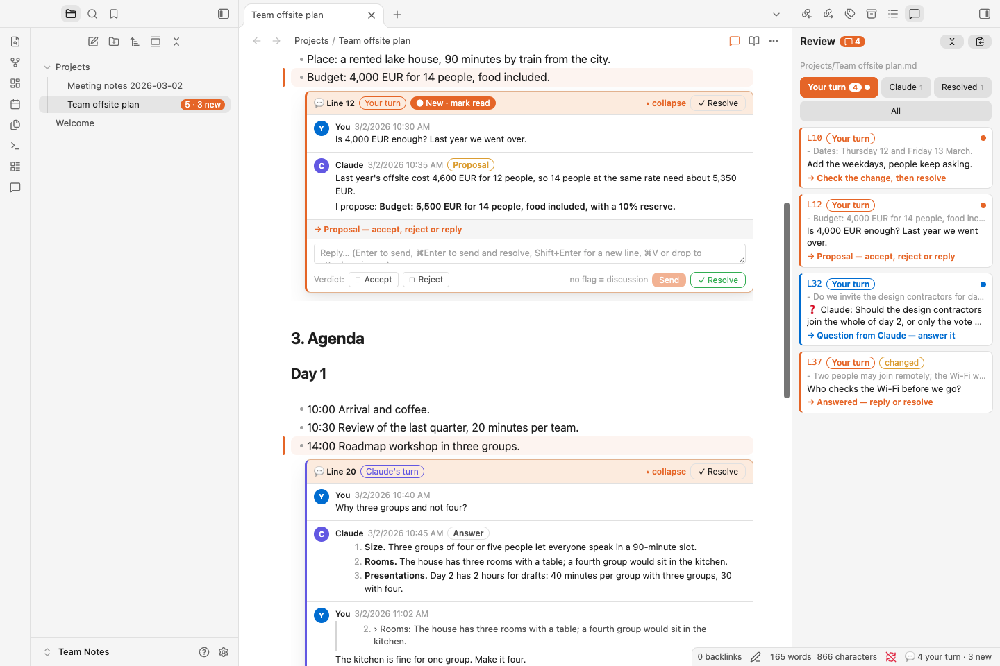
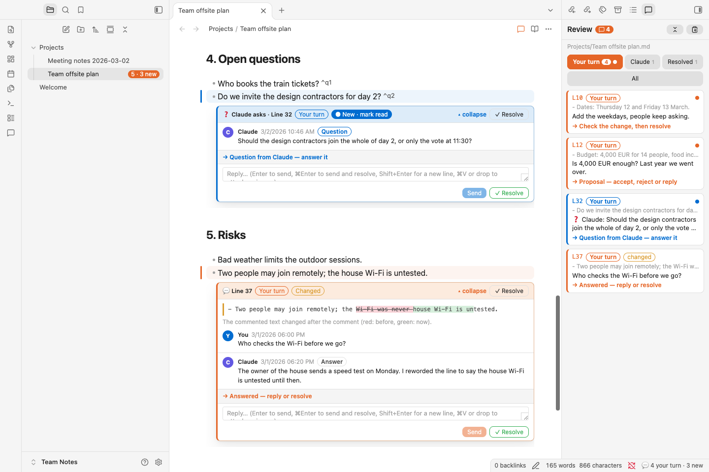
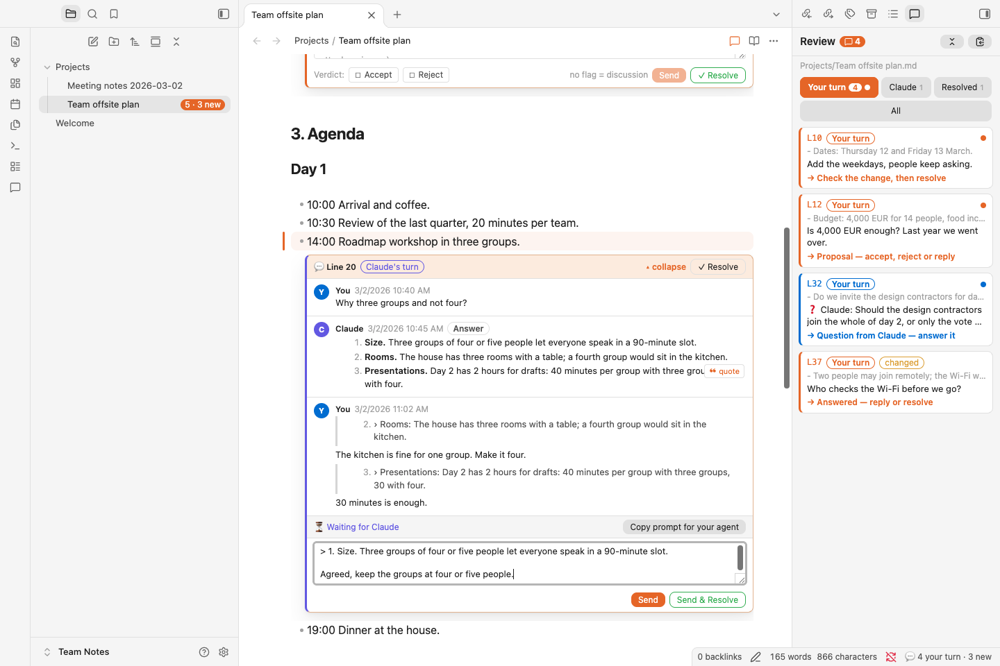
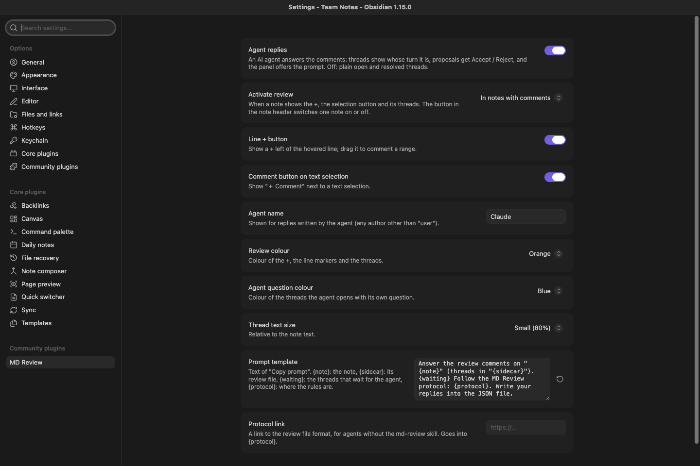

# MD Review for Obsidian

Review your Markdown notes the way you review code: comment on lines, discuss in
threads, and let an AI agent (Claude Code, Codex or any other) answer, propose changes
and edit the note.

<picture>
  <source media="(prefers-color-scheme: dark)" srcset="docs/images/overview-dark.png">
  
</picture>

## How it works

1. You add a comment on one or more lines of a note in Obsidian.
2. The plugin saves the comment in `<note>.review.json`, a plain JSON file next to
   the note.
3. You click **Copy prompt** and paste the prompt into your agent.
4. The agent reads the note and the JSON file, writes its replies into the JSON file
   and edits the note when you ask for a change.
5. The plugin watches the file and shows the replies within seconds, without a reload.

Every thread shows whose turn it is. An agent's reply has a kind, and the kind decides
your buttons: a **proposal** gets Accept / Reject, a **done** change gets "Looks good —
Resolve", a **question** waits for your answer.

The plugin has no server and makes no network requests. Your notes and comments never
leave your vault unless your agent sends them somewhere.

## Features

- Comments on a line, a range of lines (drag the **+**) or a text selection.
- Threads under the commented lines, inside the editor, with Markdown and pasted images.
- A review panel with the threads grouped by turn: yours, the agent's, resolved.
- Proposals with Accept / Reject, and **Send & Resolve** for "apply it, I trust you".
- Quote replies: answer single points of a long agent message with the **❝ quote** button.
- Threads opened by the agent itself, when it needs your decision on a line.
- Comments survive edits: when the commented lines move, the thread follows them; when
  the text changes, the thread shows the old and the new text as a diff.
- Rename-safe: when you rename or move a note in Obsidian, its review file and images
  move with it.
- A mode without an agent: plain open and resolved comment threads.

| Agent question and a changed line | Quote reply |
|---|---|
|  |  |

## Requirements

- Obsidian desktop. The plugin does not run on mobile.
- An AI agent that can read and write files in your vault, for example Claude Code.
  Without an agent the plugin still works as a comment tool (see
  [Without an agent](#without-an-agent)).
- Python 3.8 or newer, only for the agent's `open-thread.py` helper.

## Install the plugin

The plugin is not in Obsidian's community plugin directory yet. Install it in one of
these three ways.

### With BRAT (recommended)

[BRAT](https://github.com/TfTHacker/obsidian42-brat) installs plugins from GitHub and
keeps them updated.

1. Install and enable **BRAT** from Settings → Community plugins → Browse.
2. Run the BRAT command **Add a beta plugin for testing** from the command palette.
3. Enter `OWNER/obsidian-md-review` and confirm.
4. Enable **MD Review** in Settings → Community plugins.

### Manually from a release

1. Download `main.js`, `manifest.json` and `styles.css` from the
   [latest release](../../releases/latest).
2. Create the folder `<your vault>/.obsidian/plugins/md-review/` and put the three
   files into it.
3. Restart Obsidian, or reload the plugin list in Settings → Community plugins.
4. Enable **MD Review** in Settings → Community plugins. If Obsidian shows
   "Restricted mode", turn on community plugins first.

### From source

```bash
git clone https://github.com/OWNER/obsidian-md-review.git
cd obsidian-md-review
./build.sh "/path/to/your vault"
```

`build.sh` builds the plugin into `dist/` and copies it into
`<vault>/.obsidian/plugins/md-review/`. It needs Bash and `shasum`; there is no npm
step. Enable the plugin as above.

## Install the agent skill

The agent must know the format of the review file. The repository ships it in two
forms in [`agent/skills/md-review/`](agent/skills/md-review/):

- [`SKILL.md`](agent/skills/md-review/SKILL.md): a skill that tells the agent how to
  process a review, step by step.
- [`PROTOCOL.md`](agent/skills/md-review/PROTOCOL.md): the full file format and rules.
- [`tools/open-thread.py`](agent/skills/md-review/tools/open-thread.py): a helper that
  opens a new agent thread with an anchor built exactly as the plugin builds it.

### Claude Code

Copy the skill folder into your personal skills folder:

```bash
mkdir -p ~/.claude/skills
cp -R agent/skills/md-review ~/.claude/skills/md-review
```

To get updates with `git pull`, link the folder instead of copying it:

```bash
ln -s "$PWD/agent/skills/md-review" ~/.claude/skills/md-review
```

For one vault only, put the folder into `<vault>/.claude/skills/md-review/` instead.
Start Claude Code in your vault folder, so it can read and write the notes.

### Other agents

Agents that read skills in the same format (a folder with `SKILL.md`) can use the
folder as is. For any other agent, point it to `PROTOCOL.md`: set
**Settings → MD Review → Protocol link** to
`https://github.com/OWNER/obsidian-md-review/blob/main/agent/skills/md-review/PROTOCOL.md`.
The plugin then puts the link into every copied prompt.

## Your first review

1. Open a note and run the command **Start or stop review of this note**, or click the
   comment icon in the note header.
2. Hover a line and click the **+** left of it, or drag the **+** over several lines.
   Write your comment and press Enter.
3. Click **Copy prompt** in the review panel (the ribbon icon "Review comments" opens
   it) and paste the prompt into your agent. The prompt names the note, its review
   file and the threads that wait for the agent.
4. Watch the replies appear. Accept or reject proposals, reply in the threads, and
   resolve a thread when you are done.

The agent can also open threads on its own. A thread that starts with an agent question
has its own colour (blue by default) and the header "<agent> asks".



## Without an agent

Turn off **Settings → MD Review → Agent replies**. Threads then have no turns, no
verdicts and no prompt: you get plain comments that you open and resolve yourself.

## Commands

| Command | What it does |
|---|---|
| Start or stop review of this note | Shows or hides the review for the active note. |
| Add review comment on selected lines | Opens a new comment on the selected lines. |
| Open review panel | Opens the panel with the threads of the active note. |
| Copy prompt for the agent | Copies the prompt for the active note. |
| Collapse all threads in this note | Folds every thread to one line. |
| Expand all open threads in this note | Unfolds every thread that is not resolved. |
| Toggle review mode (read-only editor) | Makes the editors read-only while you review. |

## Where the data lives

- Comments for `Folder/Note.md` live in `Folder/Note.review.json`. Obsidian hides the
  file in the file explorer, because it shows only supported file types by default.
- Images pasted into comments live in `Folder/Note.review-assets/`.
- Both are ordinary files in your vault, so any sync tool (Obsidian Sync, iCloud,
  Syncthing, Git) carries them with the note.
- The plugin never overwrites a review file it cannot parse; fix the JSON first.

## Development

```bash
./build.sh              # builds dist/main.js, dist/manifest.json, dist/styles.css
node test/core.test.js  # runs the tests against dist/main.js (needs Node.js)
```

The sources are plain JavaScript without a bundler: `build.sh` concatenates the vendored
`diff-match-patch`, `core.js` and `plugin.js` into `main.js`. It refuses to build when
`vendor/diff_match_patch.js` differs from the pinned SHA-256.

To release, set the same version in `manifest.json` and `versions.json`, commit, and push
a tag equal to that version, without a `v` prefix (`0.1.1`, not `v0.1.1`). The GitHub
workflow builds the plugin, runs the tests and drafts a release with the three files.

## License

Apache License 2.0, see [LICENSE](LICENSE). The plugin bundles
[diff-match-patch](https://github.com/google/diff-match-patch), also under the Apache
License 2.0; see [NOTICE](NOTICE).
